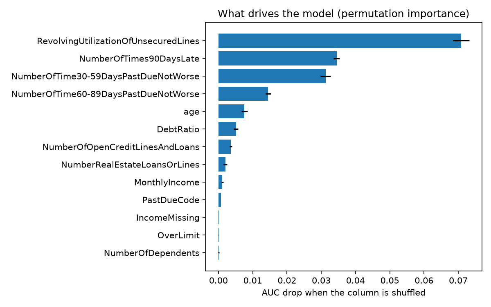
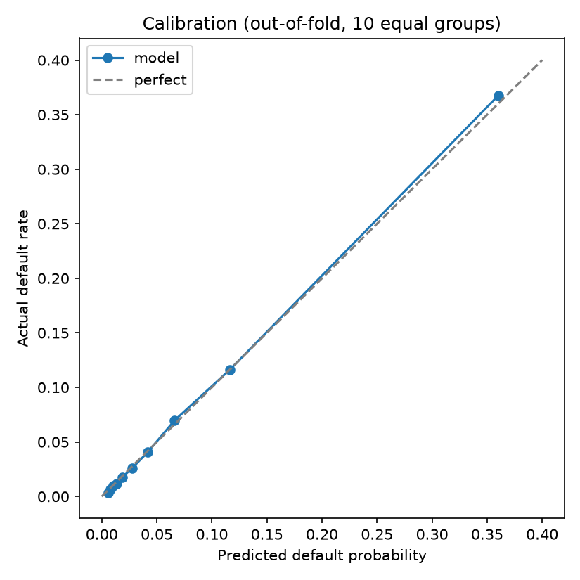
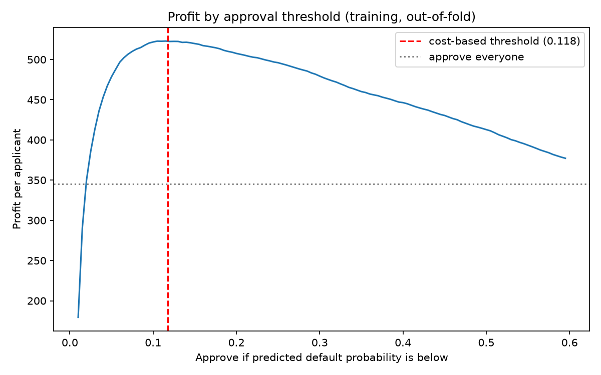

# Loan Default Prediction: Credit Risk Analysis

A model that predicts which borrowers will default on a loan, and a cost-based rule for deciding whom to approve.

**Key result:** on 30,000 held-out borrowers, approving only applicants with predicted default probability below 11.8% earns 525 per applicant, against 345 for approving everyone (+52%), while rejecting 14% of applicants. The default rate among approved loans falls from 6.7% to 2.8%. (Under stated cost assumptions, see Limitations.)

## Problem

A bank earns a profit on loans that are repaid and loses money on loans that default. Given what is known about a borrower, can we estimate the probability of default (PD) well enough to decide who should get a loan, and where should the approval cutoff be set?

## Data

Kaggle "Give Me Some Credit" (cs-training.csv): 150,000 borrowers, 10 features and 1 target (SeriousDlqin2yrs: became 90+ days overdue within 2 years). Only 6.68% of borrowers default, so accuracy is a misleading metric ("nobody defaults" is already 93.3% accurate); I use AUC, precision and recall.

Features: credit utilization, age, debt ratio, monthly income, number of dependents, open credit lines, real estate loans, and three counts of past-due payments (30-59, 60-89, 90+ days).

The data is not included in this repo. Download it from the Kaggle competition page and place it at `data/cs-training.csv`.

## Method

**1. Exploration and cleaning** (01_eda, 02_baseline)
- Split 80/20 first (stratified, random_state=42). Every cleaning value (medians, caps) is learned from the training part only and applied to both parts, to avoid leakage.
- Monthly income is missing for 19.8% of borrowers (they default slightly less often, 5.6% vs 6.9%): filled with the training median, plus a flag column.
- The past-due columns contain the codes 96 and 98 in 269 rows. These are placeholders, not real counts, and those borrowers default 55% of the time: replaced with the training median, plus a flag column.
- Where income is missing or near zero, DebtRatio holds raw amounts or exploding values: replaced or capped at the training 98th percentile (4.84). Utilization and income are capped at the 99th percentile; impossible ages are replaced with the median.

**2. Models** (03_models): compared with 5-fold stratified cross-validation (scaling inside a pipeline so nothing leaks): logistic regression, logistic regression with class weights, random forest, and LightGBM (default and tuned with a 15-combination random search).

**3. Finance layer** (04_finance)
- Drivers of default: permutation importance on a validation part of the training data.
- Costs (assumptions): loan 10,000, loss given default 60%, profit on a repaid loan 8%. A bad loan approved costs 6,000, a good loan rejected costs 800 of profit.
- Decision rule: approve if PD < margin / (LGD + margin) = 0.1176. Valid only if probabilities are calibrated, which I checked on out-of-fold predictions.
- The test set was used once, at the end, with the threshold fixed beforehand.

## Results

**Model comparison** (cross-validation on the training data; test AUC computed for the baseline and the final model only)

| Model | CV AUC (mean) | Test AUC |
|---|---|---|
| Logistic regression | 0.8502 (std 0.0043) | 0.857 |
| Logistic regression, balanced weights | 0.8552 | |
| Random forest | 0.8638 | |
| LightGBM, default | 0.8647 | |
| **LightGBM, tuned (final)** | **0.8651** | **0.8685** |

The three tree models are statistically tied (within 0.0013, about a third of the fold-to-fold spread) and all beat the logistic regression by about 0.015 AUC. I chose LightGBM because it is at least as accurate as the random forest and trains faster; tuning changed its score by only 0.0004, so it is not fragile. The logistic regression stays as the explainable reference, since a lender has to justify a refusal.

**What drives default**



Credit utilization is the strongest driver (AUC drop 0.071), followed by payment history (90+ days late 0.035, 30-59 days late 0.031, 60-89 days late 0.015). Age, debt ratio, credit lines and income have small effects. This shows what the model relies on, not what causes default.

**Calibration**



Predicted and actual default rates match closely; in the group around the cutoff, the model predicts 11.6% and the actual rate is 11.6%.

**Business result** (test set, 30,000 borrowers)

| Rule | Approved | Default rate of approved | Profit per applicant |
|---|---|---|---|
| Approve everyone | 100% | 6.7% | 345.5 |
| Model, cost-based threshold 0.1176 | 85.9% | 2.78% | 525.3 |



The profit peaks at the cost-based threshold, which matches the formula. Choosing the threshold from costs matters: at the common default of 0.5 the profit is only 413 per applicant (out-of-fold, training data).

**Robustness.** For LGD in {40%, 60%, 80%} and margin in {5%, 8%, 12%}, the model beats approving everyone in all 9 scenarios, by 74 to 323 per applicant, and the formula threshold is within 0.012 of the best searched one. With LGD 80% and margin 5%, approving everyone loses money (-68 per applicant) while the model earns +255.

## Limitations

- The costs are assumptions, not data: the dataset has no loan amounts, recoveries or interest rates. Every borrower gets the same loan of 10,000, and the margin is a flat share of the loan (no term, no funding cost).
- Medians and caps were learned on the whole training part, not inside each cross-validation fold; the effect should be small. The best score from the tuning search is slightly optimistic.
- Permutation importance describes the model, not causes. Correlated columns (the three past-due counts) share importance.
- A single historical dataset with no time dimension; no check of how the model behaves over time.
- Age is used as a feature. In real lending, using age and other personal attributes is regulated, and I did no fairness analysis.

## How to run

Requires Python 3.12.

```
git clone https://github.com/EmmaGrigoryan/loan-default-risk.git
cd loan-default-risk
python -m venv .venv
.\.venv\Scripts\python.exe -m pip install -r requirements.txt
```

Download cs-training.csv from Kaggle ("Give Me Some Credit") into a `data/` folder, then run the notebooks in this order (each one creates the files the next one reads):

1. `notebooks/01_eda.ipynb`: exploration
2. `notebooks/02_baseline.ipynb`: split, cleaning, logistic regression baseline (saves cleaned data)
3. `notebooks/03_models.ipynb`: cross-validation, random forest, LightGBM
4. `notebooks/04_finance.ipynb`: drivers, costs, threshold, charts

`notebooks/sql_practice.ipynb` holds SQL queries (SQLite) on the same data.

## Project log

- Week 1: data exploration, cleaning, logistic regression baseline (test AUC 0.857).
- Week 2: cross-validation, class weights, random forest, LightGBM; chose tuned LightGBM.
- Week 3: default drivers, error costs, cost-based approval threshold, business conclusion.
- Week 4: reproducibility (pinned requirements, fresh-clone test), charts, final README.